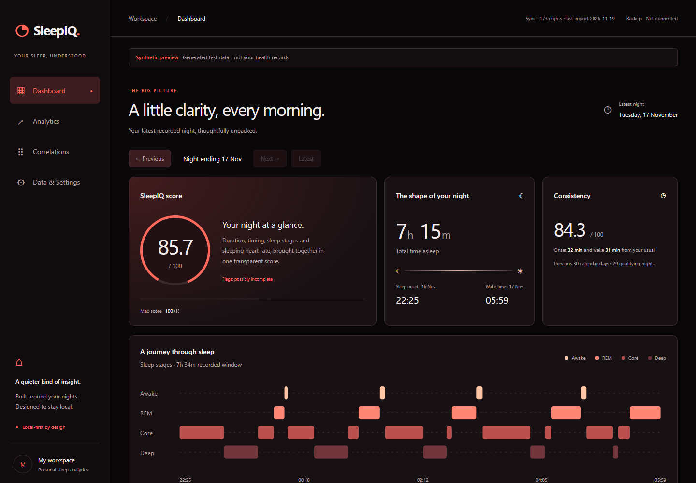
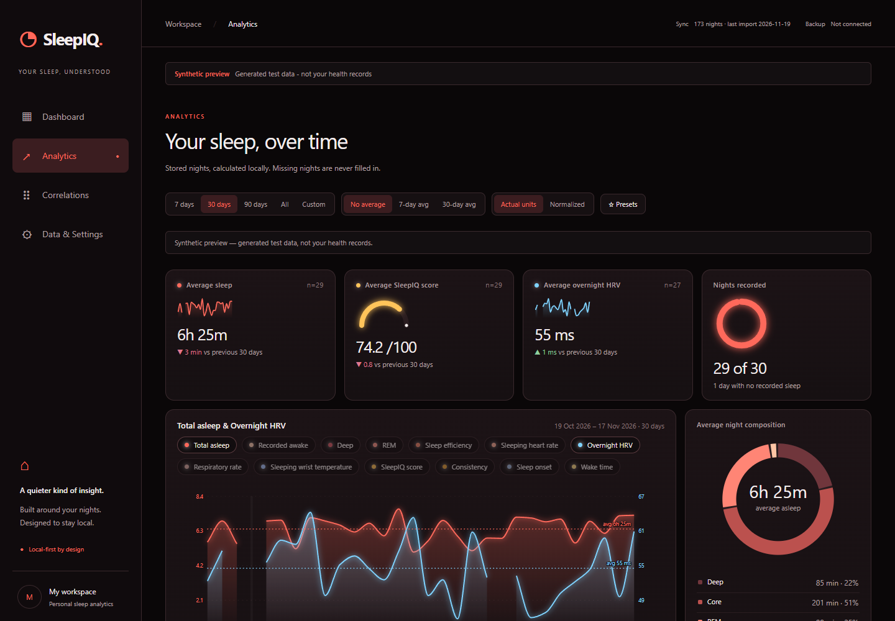
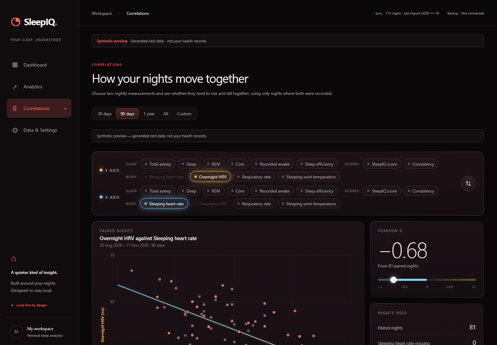
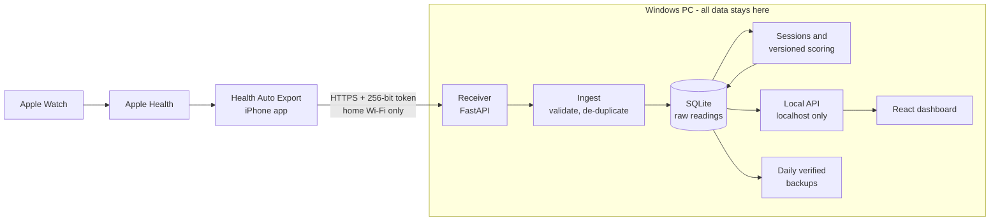

# SleepIQ

**A private, local-first sleep analytics app: Apple Watch data in, a clear nightly score and long-term trends out. No cloud.**

**[Live demo](https://matthewgilham.github.io/SleepIQ/)** (offline build with synthetic data, no real health records)



## The problem

Apple Health records detailed sleep data, but it is hard to see trends, compare measurements, or know how a "sleep score" is calculated. Most sleep apps upload your health data to someone else's cloud and keep their scoring formula secret. I wanted a sleep dashboard that:

- updates itself, with no manual exports or spreadsheets
- keeps every health record on my own PC
- uses a score I define, can read and can change later, with history recalculated consistently

## Key features

- **Automatic sync.** The iPhone sends new Apple Watch data over encrypted HTTPS on the home network. Nothing is sent to the internet.
- **Nightly dashboard.** Shows the score, time asleep, bedtime and wake time, consistency, and a timeline of sleep stages (Awake, REM, Core, Deep).
- **Transparent, versioned score.** The score uses five weighted parts: duration 25%, consistency 25%, Deep 20%, REM 20%, sleeping heart rate 10%. Each formula change becomes a new version and recalculates all past nights. Old versions stay reproducible.
- **Analytics.** Plot and overlay any of 14 nightly metrics over any date range, with rolling averages, normalized view and saved presets.
- **Correlations.** Compare any two metrics on a scatter chart, with Pearson r and a trend line, using only nights where both were recorded.
- **Honest data handling.** Missing nights are never filled in. Sleeping heart rate is time-weighted and shows its coverage and method.
- **Resilience.** Verified daily backups (14 days kept), one-step isolated restore, and CSV export.

| Analytics | Correlations |
|---|---|
|  |  |

## Tech stack

| Area | Tools |
|---|---|
| Backend | Python 3.13, FastAPI, Uvicorn, SQLAlchemy, Alembic, SQLite |
| Frontend | React 19, TypeScript, Vite, hand-built SVG charts (no chart library) |
| Testing | pytest, Vitest, Playwright |
| Quality and security | Ruff, mypy (strict), detect-secrets, pip-audit, npm audit, GitHub Actions |
| Transport | HTTPS with a Let's Encrypt certificate (DNS-01 via lego), Windows Firewall scoped to the LAN |
| Data source | Apple Watch → Apple Health → [Health Auto Export](https://www.healthyapps.dev/) (JSON v2) |

## How it works



1. **Ingest.** The receiver checks the token and request size, then stores every individual reading. Re-sending overlapping exports never creates duplicates.
2. **Derive.** Raw sleep-stage intervals become one sleep session per night. Time zones and daylight-saving changes are handled explicitly.
3. **Score.** Each night is scored by a named, versioned formula (see [docs/SCORING.md](docs/SCORING.md)). A formula change creates a new version and recalculates history in one transaction.
4. **Serve.** The dashboard and analytics API listen on `localhost` only. Only the upload endpoint is reachable from the LAN.

## Results

Measured on a synthetic 5-year store (944,042 readings, 1,826 nights) on a desktop PC:

| Operation | Time |
|---|---:|
| Full rebuild of all nights | 4.7 s |
| Full rebuild with time-weighted heart rate | 7.3 s |
| Import one new night | 0.43 s |
| Dashboard request | < 0.02 s |
| 5-year chart series | 0.04 s |
| 5-year correlation grid | 0.07 s |

Tests: **314 backend**, **53 frontend unit** and **90 end-to-end (Playwright)**, all passing. Every test uses synthetic fixtures. No real health data is in the repository.

## Run it

Needs Windows, Python 3.13, [uv](https://docs.astral.sh/uv/) and Node.js.

```powershell
uv sync --locked
npm --prefix frontend ci --ignore-scripts
npm --prefix frontend run build

# Try it with synthetic data at http://127.0.0.1:8766
uv run python scripts/preview-charts.py

# Full check suite (lint, types, all tests, build, security scan)
powershell -File scripts/check.ps1 -Suite Full
```

Connecting a real iPhone needs a domain, a certificate and a firewall rule. See [docs/SECURE_SETUP.md](docs/SECURE_SETUP.md) and [docs/SETUP.md](docs/SETUP.md).

## Project docs

Product scope, architecture, data pipeline, scoring, security and test plans are in [`docs/`](docs/). Design choices are recorded in [docs/DECISIONS.md](docs/DECISIONS.md).

## License

[MIT](LICENSE)
